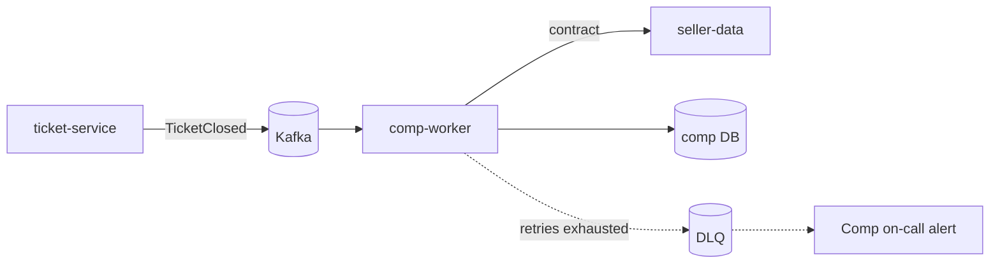

# Domain: Compensation

Owner team: Comp · Owner contact: Comp tech lead
Last reviewed: 2026-10-27

## What this domain does
Calculates the compensation owed to a seller when a support ticket is
closed in the seller's favor. Payout is out of scope (finance).

## Current behavior
`comp-worker` consumes `tickets.ticket-closed.v1`, fetches the seller's
contract from `seller-data`, calculates the amount and stores it in
`compensation_calculation`. Re-closing a ticket creates a new calculation
and supersedes the previous one.

## Rules and invariants
- At most one calculation per `(ticket_id, closure_seq)`.
- Exactly one ACTIVE calculation per ticket.
- Calculations are never updated or deleted; corrections supersede.

## Dependencies
| Depends on | For what | Failure behavior |
|---|---|---|
| tickets (`TicketClosed` event) | trigger | events wait in Kafka |
| seller-data (`GET /sellers/{id}/contract`) | commission, contract type | retry with backoff, DLQ after 30 min |

## Decisions
- [ADR-0018](adr/0018-recalculations-supersede.md) – Recalculations supersede, never overwrite
- [ADR-0017](adr/0017-async-comp-calculation.md) – Compensation is calculated asynchronously via Kafka

## Glossary
- **Closure seq** – counter on a ticket that increases each time it is closed.
- **Active calculation** – the one currently owed to the seller.
