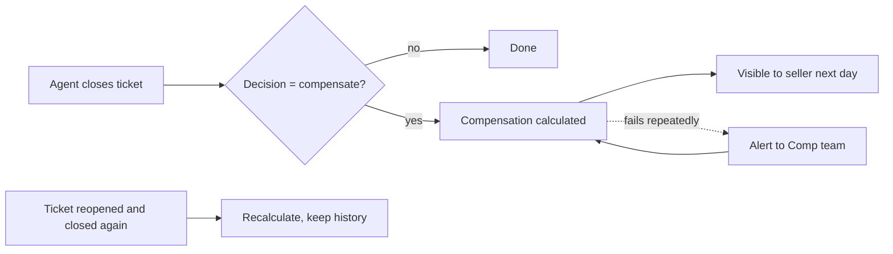

# PRD: No more lost seller compensations

Status: Approved · Owner (PM): Comp PM · Brief: [brief.md](brief.md)

## Scope
Guarantee that every eligible closed ticket produces exactly one compensation
calculation, and make failures visible instead of silent.

## User flows

## Business rules
| # | Rule | Example |
|---|---|---|
| R1 | One calculation per ticket closure | Ticket 123 closed once → 1 record |
| R2 | Amount rules unchanged | Same formula as today |
| R3 | Reopen + re-close creates a new calculation that replaces the previous one as "active"; previous stays in history | 500 TL → reopened → 650 TL: active = 650, history keeps 500 |
| R4 | A calculation that cannot complete within 30 min alerts the Comp team | |

## Edge cases
- Seller data temporarily unavailable → retry, do not drop.
- Same closure event delivered twice → still one calculation (R1).
- Ticket closed with decision "no compensation" → nothing happens.

## Acceptance criteria
- **AC1** Given a ticket closed with "compensate", when seller-data is up, then a compensation is calculated within 5 minutes.
- **AC2** Given seller-data is down for 10 minutes, when a ticket is closed, then the compensation is calculated after it recovers, with no manual action.
- **AC3** Given the same closure event arrives twice, then only one compensation exists.
- **AC4** Given a compensated ticket is reopened and re-closed with a new amount, then the new amount is active and the old one is in history.
- **AC5** Given a calculation keeps failing for 30 minutes, then the Comp team receives an alert.

## Open questions
- [x] Who receives the alert in AC5? → Comp team on-call channel.

## Approval
- [x] PM: Comp PM (2026-10-10)
- [x] Business owner (scope check): Seller Ops lead (2026-10-10)
