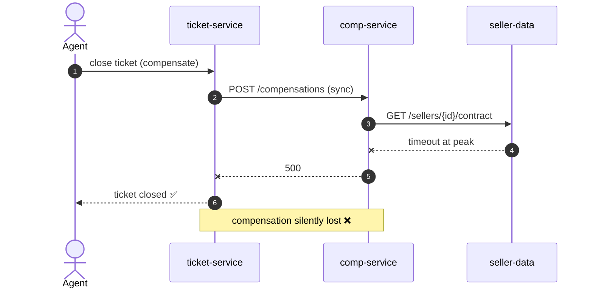
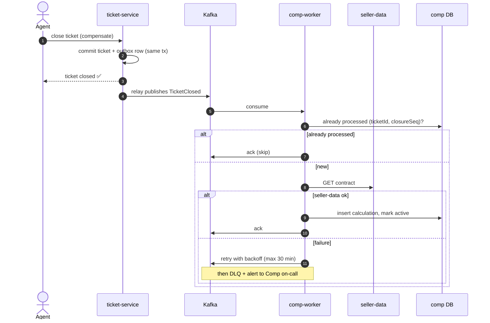
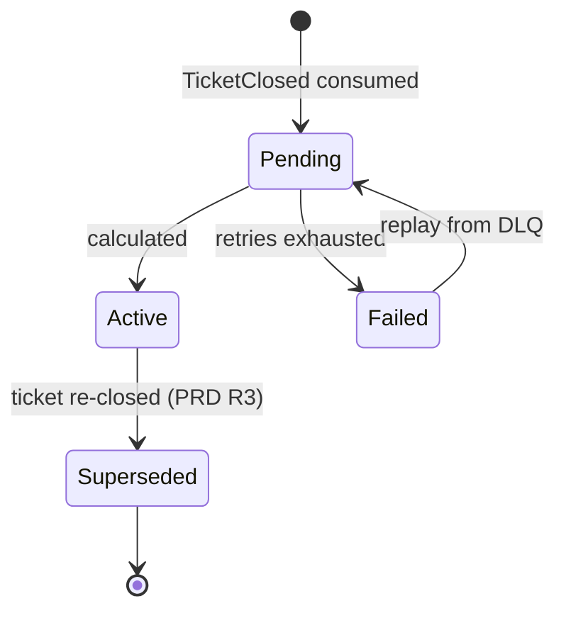
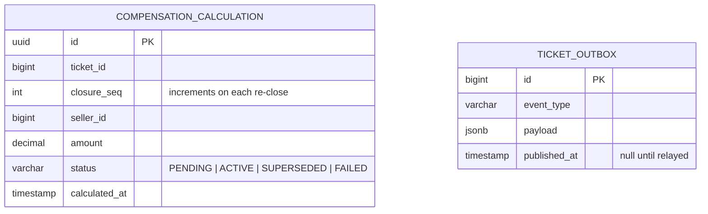

# RFC-042: Async compensation calculation for sellers

Status: Accepted
Author: Salih · PRD: [prd.md](prd.md)
Approvers: Comp tech lead, Seller Data owner, Tickets owner
Review deadline: 2026-10-25 (lazy consensus)

## Context
Today `ticket-service` calls `comp-service` synchronously while closing a
ticket, and `comp-service` calls `seller-data` to fetch commission and
contract details. At peak, `seller-data` p99 exceeds the 2 s timeout, the
call fails, the ticket still closes, and the compensation is lost.
See [compensation context](../../domains/compensation/context.md).

## Goals / Non-goals
- Goal: zero lost compensations (PRD AC1–AC3)
- Goal: ticket closure no longer depends on seller-data availability
- Non-goal: changing calculation rules, payouts

## Proposal
`ticket-service` writes a `TicketClosed` event to an outbox table in the same
transaction that closes the ticket. A relay publishes it to Kafka topic
`tickets.ticket-closed.v1`. A new `comp-worker` consumes it, fetches seller
data, calculates and stores the compensation. Processing is idempotent on
`(ticketId, closureSeq)`. Failures retry with backoff; after the retry budget
the event goes to a DLQ and alerts.

### Calculation lifecycle

## Data model changes

Unique index on `(ticket_id, closure_seq)` enforces idempotency (AC3).

## Alternatives considered
1. **Keep sync, add retries in ticket-service** – ticket closure stays coupled to seller-data; retries at peak make the overload worse.
2. **Nightly batch over closed tickets** – simple, but up to 24 h delay and failures are found a day late.
3. **Publish to Kafka directly from ticket-service (no outbox)** – event can be lost if publish fails after the ticket commit; outbox removes that gap.

## Impact
- Services: `ticket-service` (outbox + relay), new `comp-worker`, `seller-data` (read only, no change)
- Data: two new tables, no migration of existing data
- External dependencies: none new (Kafka already in use)
- Security / PII: event carries ids and amounts only, no seller personal data
- Rollout: feature flag; 1 week shadow mode where comp-worker calculates but sync path remains source of truth; compare results; then switch
- Rollback: turn flag off, sync path still present until removal task
- Observability: consumer lag, DLQ size, pending older than 5 min (alert at 30 min)

## Tasks (become Jira cards)
- [ ] Outbox table + relay in ticket-service
- [ ] `comp-worker` consumer with idempotency
- [ ] Retry/DLQ config + alert to Comp on-call
- [ ] Shadow mode comparison dashboard
- [ ] Switch flag, remove sync call

## Decisions (become ADRs on merge)
- D1: Compensation is calculated asynchronously from `TicketClosed` events → ADR-0017
- D2: Recalculations create a new record and supersede the old one; nothing is overwritten → ADR-0018

## Open questions
- [x] Overwrite or append on reopen? → Append and supersede (D2, PRD R3).
- [x] Who owns DLQ alerts? → Comp team on-call.
