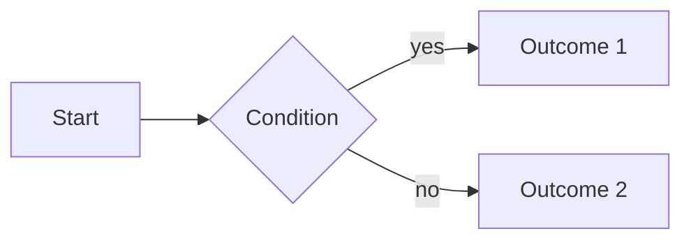

# PRD: <feature name>

Status: Draft | Approved · Owner (PM): <name> · Brief: [brief.md](brief.md)

## Scope
<What is in. Link to brief for the "why".>

## User flows

## Business rules
| # | Rule | Example |
|---|---|---|
| R1 | <rule> | <concrete example with numbers> |

## Edge cases
- <What happens when ...?>

## Acceptance criteria
<!-- Given/When/Then. Tester derives test cases from these. -->
- **AC1** Given <state>, when <action>, then <result>.

## Open questions
- [ ] ...

## Approval
- [ ] PM: <name>
- [ ] Business owner (scope check): <name>
