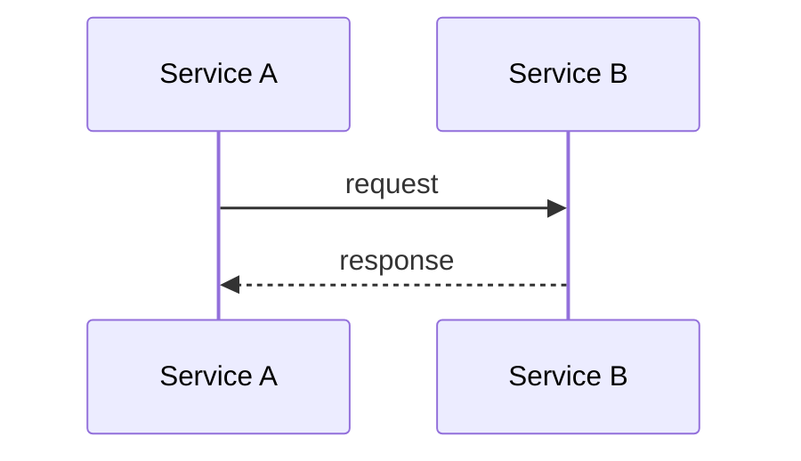
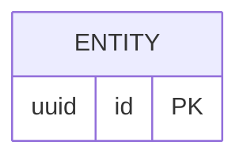

# RFC-NNN: <title>

Status: Draft | In review | Accepted | Rejected
Author: <name> · PRD: [prd.md](prd.md)
Approvers: <tech lead>, <affected domain owners>
Review deadline: <yyyy-mm-dd> (lazy consensus: no blocking comment by then = approved)

## Context
<Current state and why it is not enough. Link domain context files.>

## Goals / Non-goals
- Goal: ...
- Non-goal: ...

## Proposal
<The design. Keep it as short as possible but no shorter.>

## Data model changes

## Alternatives considered
1. <Option> – <why rejected>

## Impact
- Services: ...
- Data / migrations: ...
- External dependencies: ...
- Security / PII: ...
- Rollout & rollback: ...
- Observability: ...

## Tasks (become Jira cards)
- [ ] ...

## Decisions (become ADRs on merge)
- D1: ...

## Open questions
- [ ] ...
